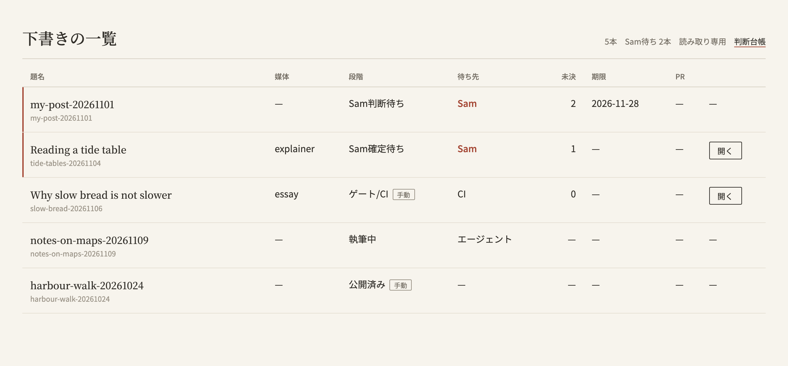
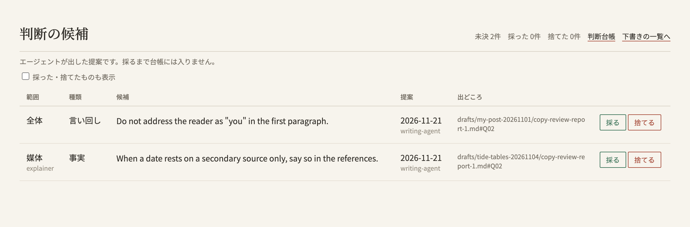
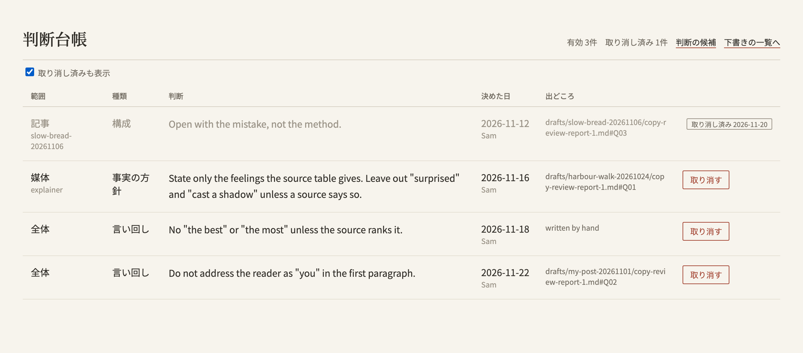

# Bragi

Bragi keeps the decisions an author has made about their writing, and puts them in front of the agents that help write it.

It is a small set of local tools over plain files:

- a **decision ledger**: one Markdown file per decision ("never state a feeling the source table does not give"), kept in a folder you own;
- **`bragi`**, a command-line reader, and an **MCP server** (Model Context Protocol) that give an agent the decisions that apply to one article (global, per medium, per article);
- a read-only **list of drafts** with the stage each one has reached, and a **local editor** for the manuscript, which also holds the one screen where a decision is made;
- **candidates**: questions a review report raised, and decisions an agent proposes. Candidates are not decisions.

Everything is a file in your folders. There is no database and no hosted service; the editor listens on `127.0.0.1` only. The `bragi` command and the MCP server read GitHub (through your own `gh` login) only when you pass `--github`. The editor asks GitHub for PR state when it loads the list, if `--pr-repo` is given or an article names a repository or a PR (details under "More about the list").

## The idea

Only a person turns a judgement into a rule.

An agent may read the ledger. An agent may propose a decision, and the proposal lands in a separate folder that the ledger reader never looks at. Only the person, in the editor's UI, adopts a proposal: that creates exactly one new ledger file and marks the proposal adopted. The MCP server has no tool to adopt, reject or write the ledger, so no prompt can make the server do so. That is the limit of the guarantee: the MCP server and `bragi` cannot write the ledger. It does not stop an agent that has file permissions of its own from editing the ledger folder directly. Nor does it stop another local process from calling the editor's adopt endpoint: a request with `Origin: http://127.0.0.1:<port>` and `Content-Type: application/json` is accepted, and the tool does not check who sends it.

Because a rule that outlives its reason does harm, a decision can be retired. Retiring edits two lines of one file (on the editor's ledger screen, `#/ledger`), and a retired decision is never handed to an agent.

## How it works


Dashed lines read; thick lines write. An agent can read drafts and the ledger and can write one thing: a candidate in the proposals folder. Only the editor writes to the ledger, and only when you press a button.

One decision's life, from a review question to a rule that reaches the next article:


## Status

Published on GitHub. The packages are `private` on purpose: nothing here is meant for `npm publish`. Use it from a checkout.

## Requirements

Node.js 22.18 or newer (the code runs as TypeScript with the types stripped) and npm. `gh` is optional. With it, the editor's list shows PR state, CI and review-gate verdicts; `bragi` and the MCP server show them too when you pass `--github`. Without it, the list still shows, with PR state marked unknown.

The editor's interface and the generated reports are in Japanese. The names of stages and of the author are settings (below); the rest of the interface text is not yet translatable.

## Install

```sh
git clone https://github.com/Fiction000/bragi.git && cd bragi
npm ci --ignore-scripts
npm run build          # the editor's front end
npm test && npm run typecheck
```

Below, `bragi` stands for `node packages/core/src/bragi.ts`, run from the checkout. Inside the checkout, `npx bragi` runs the same file.

## Configure

Nothing is found by a built-in path. Point Bragi at your folders with environment variables, or with one JSON file named by `BRAGI_CONFIG`. Precedence, highest first: a command-line flag, the environment, the file, the default.

| environment | file key | meaning | default |
|---|---|---|---|
| `BRAGI_CONFIG` | | path of a JSON file with the keys in this table | none |
| `BRAGI_VAULT` | `vault` | the folder everything else is under | none |
| `BRAGI_DRAFTS` | `drafts` | folder with one sub-folder per article | `drafts` |
| `BRAGI_LEDGER` | `ledger` | the decision ledger | `ledger` |
| `BRAGI_PROPOSALS` | `proposals` | proposed decisions, outside the ledger | `proposals` |
| `BRAGI_TASKNOTES` | `taskNotes` | notes with `key`, `kanban`, `due` and `status` in their front matter, for due dates | none |
| `BRAGI_TASK_IDS` | `taskIds` | regular expressions for the task ids an article's files may mention (environment: separated by `\|\|\|`) | none |
| `BRAGI_AUTHOR` | `author` | what the deciding person is called in labels and in `decided_by` | `著者` |
| `BRAGI_TIMEZONE` | | IANA time zone for the dates written into files | the machine's |
| | `stageLabels` | names of the stages; `{author}` is replaced by the author | see below |

A relative path is resolved against the vault; an absolute path stands alone. With nothing configured, `bragi` exits 1 and says which setting is missing.

Command-line flags differ by tool:

- `bragi`: `--drafts-root`, `--ledger`, `--tasknotes`, `--drafts-index`, `--github`, `--json`.
- MCP server: `--drafts-root`, `--ledger`, `--proposals`, `--tasknotes`, `--drafts-index`, `--github`, `--pr-repo owner/name`.
- Editor: `--drafts-root`, `--ledger`, `--proposals`, `--tasknotes`, `--drafts-index`, `--pr-repo owner/name`, `--port`, `--run <dir>`, `--public-host` (with the `--access-*` flags below). It has no `--github`.

A starting point is in `bragi.config.example.json`. Keep your own copy outside the repository or under the name `bragi.config.json`, which `.gitignore` excludes.

## The smallest setup on an existing vault

You keep notes in `~/notes`. Articles live in `~/notes/blog/drafts`, and you want the decisions in `~/notes/blog/decisions`:

```sh
export BRAGI_VAULT=~/notes
export BRAGI_DRAFTS=blog/drafts
export BRAGI_LEDGER=blog/decisions
export BRAGI_PROPOSALS=blog/proposed
export BRAGI_AUTHOR=Sam

node packages/core/src/bragi.ts list                       # one line per article; the first column is its slug
npm start                                                  # the list and the editor, http://127.0.0.1:4317
```

Put in a first decision and check that it comes out. `my-post-20261101` stands for the slug of one of your own articles (a folder name under the drafts root, as `list` prints it); replace it. The ledger folder does not exist yet, so create it:

```sh
mkdir -p ~/notes/blog/decisions
cat > ~/notes/blog/decisions/D-2026-11-16-no-unsourced-feelings.md <<'EOF'
---
id: D-2026-11-16-no-unsourced-feelings
scope: global
kind: fact-policy
status: active
decided_by: Sam
decided_at: 2026-11-16
source: written by hand
---

State only the feelings the source table gives.
EOF
node packages/core/src/bragi.ts context my-post-20261101   # prints the decision (the headings are in Japanese)
```

`scope: global` applies the decision to every article. The file name must be `<id>.md`. The other fields are described under "The ledger".

An entry for the same setup, to put in the configuration of an MCP-capable client (where it goes depends on the client):

```json
{
  "command": "node",
  "args": ["/path/to/bragi/apps/mcp/src/server.ts"],
  "env": { "BRAGI_VAULT": "/path/to/notes", "BRAGI_DRAFTS": "blog/drafts", "BRAGI_LEDGER": "blog/decisions", "BRAGI_PROPOSALS": "blog/proposed", "BRAGI_AUTHOR": "Sam" }
}
```

It does not pass `--github`, so PRs show as unknown through MCP. To ask GitHub, add `"--github"` to `args`.

Bragi never creates your folders on a read. The proposals folder is created the first time an agent proposes something.

## What a drafts folder looks like

One folder directly under the drafts root is one article. The slug is the folder name.

```
drafts/
  my-post-20261101/
    copy-review-report-1.md        # a review report (name rule below); its `status:` line (e.g. needs_input) drives the stage
    article.yaml                   # optional: repo, branch, pr (the record of which PRs belong to it)
    status.override.json           # optional: the only hand-set state
    editor-run/
      editor-targets.json          # the manuscripts the editor may open
      05_final/<file>.md
      05_final/editor/<id>/finished.json   # written by the editor when the author finishes
  drafts.index.yaml                # optional: articles that have no folder (see drafts.index.example.yaml)
```


The stage is derived from these files and never written by hand. The furthest progress wins, so an old `needs_input` report next to an editor run does not hold the article back.

| stage key | default name | rule |
|---|---|---|
| `published` | 公開済み (published) | a linked PR is merged and none is open |
| `awaiting-confirm` | {author}確定待ち (awaiting the author's confirmation) | an editor target lacks `finished.json`, whether or not a PR is open; an open PR with no editor run counts the same. A PR does not mean the author confirmed |
| `gate-ci` | ゲート/CI (gate and CI) | confirmed, PR open, and either CI is not green or the gate verdict is missing, belongs to an older head, or is `BLOCKED` or `MANUAL_CHECK` |
| `merge-ready` | マージ待ち (ready to merge) | confirmed, PR open, CI green, and the gate comment says `MERGE_OK` or `NEEDS_<WORD>` for the current head |
| `pr-unknown` | PR不明 (PR unknown) | every target is finished but no PR is found; "waiting for a PR" is not claimed |
| `awaiting-decision` | {author}判断待ち (awaiting the author's decision) | the latest review report says `status: needs_input` |
| `writing` | 執筆中 (writing) | none of the above |
| `awaiting-pr` | PR待ち (awaiting a PR) | never derived; only `status.override.json` can set it |

A PR whose state `gh` could not read is treated as open. The stage keys are what `stageLabels` and `status.override.json` use. The gate verdict is read from a PR comment (format under "Conventions of your workflow"); any `NEEDS_<WORD>` is reported as `NEEDS_AUTHOR`. The rules are in `packages/core/src/stage.ts` and are pinned by `packages/core/test/scan.test.ts`.

Rename a stage in the config file:

```json
{ "stageLabels": { "writing": "Drafting", "awaiting-decision": "{author} to decide" } }
```

More about the list:

- **PRs.**
  - Lookup. The editor looks PRs up with `gh` by default when the list loads, if there is something to look up. `bragi` and the MCP server do so only with `--github`. Something to look up is any of these:
    - `--pr-repo`;
    - a `repo` or `pr` in `article.yaml` (or in the article's `drafts.index.yaml` entry);
    - a `pr` in `status.override.json`;
    - a PR URL in a report-like file of the article folder (a `.md` file whose name contains `report`, `報告`, `ledger` or `台帳`).

    All PRs of all articles are read with one `gh api graphql` call (state, head SHA, CI, the gate comment, unresolved review threads), cached for 60 seconds.
  - Matching. `article.yaml` (`repo`, `branch`, `pr`) is the record and wins. Without it, PRs are guessed from report text or from a head branch that contains the folder name without its date, and every guess is marked 推測 (a guess). `--pr-repo owner/name` adds a repository to the branch search.
  - Without `gh`. If `gh` fails the list still shows, with PRs as 状態不明 (state unknown).
- **Open decisions (未決).** The questions of a `needs_input` report that holds the article at the decision step, plus the `〔<author>の…〕` and `〔要確認…〕` placeholders still in the manuscript. Structural markers such as `〔図1：キャプション〕` are not counted.
- **Due date (期限).** `status.override.json`, then `drafts.index.yaml`, then the task note (see `BRAGI_TASKNOTES`) whose `key` or `kanban` id the article's files mention most, then a `due:` line in a brief. Finished task notes are ignored.
- **`status.override.json`.** `{ "stage": "...", "waiting_on": "...", "due": "YYYY-MM-DD", "pr": "https://..." }`, all keys optional. `waiting_on` is `agent`, `author`, `ci` or `none`.
- **Articles without a folder** go in `drafts.index.yaml` at the drafts root; they are marked 手で登録 (registered by hand).

The list only reads: `/api/dashboard` accepts GET, the scan opens files for reading, and the UI sends no other request.

## Conventions of your workflow (optional)

The list reads some file names and formats by fixed rules. Bragi does not create these files, and none is required.

- **Review reports.** A file directly in the article folder (or listed in an article's `drafts.index.yaml` entry) counts as a review report when it is a `.md` file whose name contains `copy-review` and `report` (or `報告`), in any case, and does not contain `brief` or `反映記録`. `bragi candidates` and `bragi recurrence` also skip names that contain `ledger` or `台帳`. A line that starts with `status:` gives the report's status (lower-case letters and `_`, in front matter or in the body); `needs_input` puts the article at the decision step, and the newest report by modification time counts. Questions are headings or bullets that begin with `Q01`, `Q02`…. A line `媒体: <name>` (or `媒体：<name>`) gives the article's medium when nothing else does. Without a matching name the report is ignored: no stage, no candidates.
- **Findings table.** `bragi recurrence` counts the rows of a Markdown table whose header has an `ID` (or `#`) column, a `旧` (or `原文`) column and a `区分` column. A row counts when its ID looks like `E01` (one or two capital letters, then one to three digits, optionally a lower-case letter) and its `区分` value starts with `auto` or contains `decision`, `needs_input` or `判断`. Without such a table, `bragi recurrence` counts nothing.
- **Review-gate comment.** A PR comment carries the verdict as `pr_gate <VERDICT>` or `自動レビューゲート: <VERDICT>` anywhere in its text. The verdict is `MERGE_OK`, `NEEDS_<WORD>`, `MANUAL_CHECK` or `BLOCKED`. The newest comment with a verdict counts. If the comment names a head (`head <sha>`, with or without backticks, 7 to 40 hex characters), the verdict is for the current head when that SHA and the PR's head share a prefix, and stale otherwise (a stale verdict counts as missing). A comment that names no head counts as current. Two examples of comments it reads:

  ```
  pr_gate NEEDS_AUTHOR (content only), CI green, head b2dc046a47817bf60e450a7be599c8db78dca9d8.
  ```

  ```
  ### 自動レビューゲート: BLOCKED
  head `b2dc046a47` / CI: failing
  ```

  Nothing in this repository writes these comments. Without them a PR with a green CI stays at `gate-ci`.
- **Editor runs.** The editor opens a manuscript through `editor-targets.json`, found in the article folder or up to two folders below it (for example `editor-run/`), except under `node_modules`, `05_final`, `out` and `evidence`. Its smallest form:

  ```json
  {
    "targets": [
      { "id": "main", "title": "My post", "medium": "explainer", "version": "draft 1", "source": "05_final/my-post.md" }
    ]
  }
  ```

  `id` is lower-case letters, digits and hyphens (up to 64) and unique. `title`, `medium` and `version` are strings. `source` is a path relative to the folder of `editor-targets.json`, without `..`, to a file inside it. The editor needs all five; the list itself reads `id`, `title`, `medium` and `source`. The editor writes `05_final/editor/<id>/nat-final.md`, `nat-notes.json` and, when the author finishes, `finished.json`. These names are fixed. Without `editor-targets.json` the article has no editor run and cannot be opened for editing.
- **Placeholders.** A `〔label〕` in the manuscript is an open decision when the label starts with the author's name (`BRAGI_AUTHOR`) or contains `要確認`, `要入力`, `未記入`, `TBD` or `TODO`. Other labels, such as `〔図1：キャプション〕`, are not counted.

## The ledger

One decision, one file, `D-<date>-<slug>.md`, in the ledger folder:

```markdown
---
id: D-2026-11-16-no-unsourced-feelings
scope: medium            # draft | medium | global
medium: explainer        # required for scope=medium, forbidden otherwise
draft: null              # the article slug for scope=draft
kind: fact-policy        # fact | phrasing | structure | fact-policy | tag-policy
status: active           # active | retired (a retired one also has retired_at)
decided_by: Sam
decided_at: 2026-11-16
source: drafts/my-post-20261101/copy-review-report-1.md#Q01
check:
  type: none             # or: { type: regex, pattern: "...", message: "..." }
---

State only the feelings the source table gives. Leave out "surprised" and "cast a shadow" unless a source says so.
```

Unknown keys are an error, except common note-taking metadata (`tags`, `created`, `updated`, `agent_generated`, `aliases`, `owner`, `sources`, `project`), which is accepted and ignored. A file that cannot be read is reported with the reason and does not stop the others. Creating a decision never overwrites a file; retiring changes the status line and adds `retired_at`. The id is `D-YYYY-MM-DD-<slug>` (lower-case letters, digits and hyphens in the slug), and the file name must be `<id>.md`; a file whose name differs is reported as unreadable.

## Candidates

A candidate is not a decision. There are two kinds.

- **From a review report.** `bragi candidates <slug>` (and the `get_candidates` tool) lists the questions (`Q01`, `Q02`…) in an article's review reports. Each is `in-ledger` (a decision's `source` already cites it), `answered` (the report carries an answer) or `open`. Nothing is written.
- **From an agent.** `propose_decision` writes `P-<date>-<slug>.md` in the proposals folder, with the same fields a decision has plus `proposed_by`, `proposed_at` and `status: pending | adopted | rejected`. It is validated with the ledger's own schema first. The same wording for the same scope returns the existing proposal. The editor shows the folder at `#/proposals`, where the person adopts or rejects (`GET /api/proposals`, `POST /api/proposals/adopt|reject`).

`bragi recurrence [slug]` counts in how many articles the findings of the review reports fall under each active decision, by fixed rules, tried in this order: the decision's id named in the finding, the decision's check regex, a phrase in 「」 brackets from the decision's text, a tag. No model is involved. The tags are six built-in topics (`unsourced-feeling-evaluation`, `superlative`, `translator-intent`, `reread-invite`, `edition-claim`, `secondary-source`), matched against the decision's text and the finding with Japanese patterns, defined in `packages/core/src/recurrence.ts`. A decision's `tags:` key is not used, and no setting adds a topic. A decision's own article is not counted: it is the one named by the decision's `draft` key, or else by the `drafts/<slug>/` part of its `source`.

## MCP tools

`node apps/mcp/src/server.ts`, over stdio. Flags: `--drafts-root --ledger --proposals --tasknotes --drafts-index --pr-repo --github`.

Read-only (`readOnlyHint`):

| tool | returns |
|---|---|
| `list_drafts` | every article: slug, title, medium, stage, who it waits on, open decisions, due date, PRs |
| `get_draft` | everything the scanner knows about one article, including why it is at that stage |
| `get_context` | the active decisions that apply to one article, as Markdown to paste into a brief |
| `get_candidates` | the questions of one article's review reports as candidate decisions |
| `get_recurrence` | how many articles each active decision recurs in |

The one write:

| tool | effect |
|---|---|
| `propose_decision` | creates one file in the proposals folder. Never touches the ledger and never reaches `get_context` until a person adopts it |

Unknown ids come back as an error that lists the known ones. `stdout` carries only the protocol.

## The editor

The screens, from a made-up vault (the interface text is Japanese, as noted above). The list:



An agent's candidates wait on their own screen until you adopt or reject them:



An adopted candidate becomes a ledger file; a decision you no longer want is retired, not deleted:




`npm start` serves the list at `/`; each article's manuscript opens at `/r/<key>/`. The server binds only to `127.0.0.1` (port 4317, or `--port`). Original files stay untouched: edits and reasons are stored under `05_final/editor/<id>/`, and finishing is an explicit action; autosave alone never marks a draft finished. A key is opaque and never a path; only runs the scanner found can be opened. `npm start -- --run <dir>` opens a single run.

### Behind Cloudflare Access

`--public-host <name>` makes the server also answer for that hostname (for example through a Cloudflare Tunnel to the loopback port). It must come with `--access-team <team>.cloudflareaccess.com`, `--access-aud <application AUD>` and one or more `--access-email <owner>`; without them the server does not start. Every request with that Host needs a `Cf-Access-Jwt-Assertion` signed by the team (RS256, keys from `/cdn-cgi/access/certs`), for that AUD, unexpired, from a listed email; service tokens are refused. Writes also need `Origin: https://<name>`. Requests to `127.0.0.1` keep working.

## Develop

```sh
npm test            # packages/core, apps/editor, apps/mcp
npm run typecheck
npm run build
npm run test:e2e    # needs Playwright's browsers; screenshots go to apps/editor/test-results/evidence (or $WLE_EVIDENCE_DIR)
```

`docs/diagrams/*.mmd` are the sources of the SVG diagrams (Mermaid flowcharts, rendered with Pele). `node docs/make-screenshots.mjs` rebuilds `docs/images/*.png` from a made-up vault in a temp folder; it needs `npm run build` first and Playwright's browsers.

The tests use only invented articles and decisions. Run them with the `BRAGI_*` variables unset: the suites that need a setting set it themselves.

| path | what |
|---|---|
| `packages/core` | scanner, ledger, proposals, report parsing, settings; the `bragi` command |
| `apps/mcp` | the MCP server |
| `apps/editor` | the HTTP server and the React front end |

The packages are named `@wle/*` after the project's first name, "writing local editor".

## Licence

MIT, see `LICENSE`.
